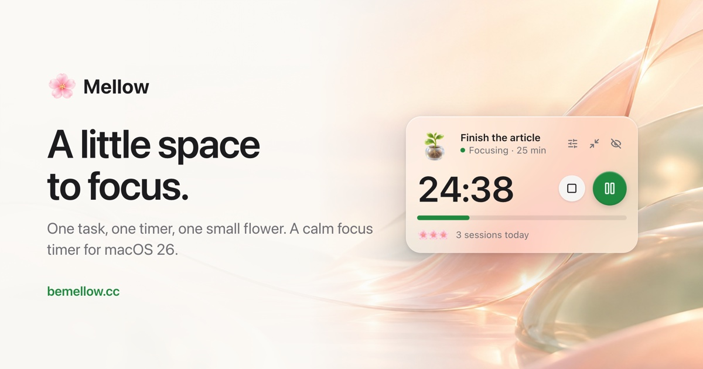

# Mellow

A tiny focus timer that floats at the edge of your Mac. Name one task, start the clock, and
watch a small companion grow.

[](https://bemellow.cc)

**[Download for Mac](https://bemellow.cc)** · [Releases](https://github.com/oybekruziev/mellow/releases) · Free, macOS 26 Tahoe or later

## What it does

- **One task at a time.** A small Liquid Glass panel holds a task and a timer (15, 25, 45, 60 or
  any 1–120 minutes). Hide it or shrink it to a capsule; the time stays in the menu bar.
- **Plans.** Line up to 20 tasks with their own lengths and breaks, and see when you will be done.
- **Companions.** A plant, cat, candle, fox, coffee, moon or cactus grows a stage every quarter
  of a session. Each finished session earns a flower for today.
- **Lofi.** 13 public-domain tracks by HoliznaCC0 that can start and stop with your timer.
- **Keyboard first.** Space starts or pauses, ⌘P plans, ⌘M shrinks, ⌘. ends, ⌘, opens Settings.
- **Private.** No account and no analytics. The only network request is a check for a new
  version on GitHub Releases every few hours.
- **Accessible.** VoiceOver labels, keyboard focus, Reduce Motion and Reduce Transparency.

## Build from source

You need macOS 26 and Xcode 26. There are no third-party dependencies.

```sh
git clone https://github.com/oybekruziev/mellow.git
cd mellow
open Mellow.xcodeproj        # scheme "Mellow", then Run
```

From the terminal:

```sh
zsh scripts/build.sh         # Release build in Build/Mellow.app (ad-hoc signed)
zsh scripts/test.sh          # core tests (swift test)
```

A Debug build can render every panel state to PNG, handy when you change the UI:

```sh
MELLOW_SNAPSHOT_DIR=/tmp/mellow-snapshots path/to/Debug/Mellow.app/Contents/MacOS/Mellow
```

## Project layout

| Path | What is there |
|---|---|
| `Sources/MellowCore` | The timer engine, session states, plans, daily stats and settings. Pure Swift, fully tested. |
| `Tests/MellowCoreTests` | Tests for every state and event, and the plan flow. |
| `Mellow/Views` | SwiftUI panel, capsule, plan editor, settings, onboarding and the companions. |
| `Mellow/Window` | The non-activating floating panel and where it sits on screen. |
| `Mellow/MenuBar` | Menu bar label and menu. |
| `Mellow/Music` | The lofi player. |
| `Mellow/Update` | In-app updates from GitHub Releases, with signature checks. |
| `Mellow/Debug` | Debug-only snapshot renderer and stress test. |
| `website/` | The bemellow.cc landing page: plain HTML, CSS and JS on a Cloudflare Worker. |

## Contributing

Bug reports, ideas and pull requests are welcome. Start with [CONTRIBUTING.md](CONTRIBUTING.md).

## License

The code is open source under the [MIT License](LICENSE).

The **Mellow** name, the blossom logo, the app icon and the mascot artwork are not covered by
it. You can fork and change Mellow freely, but a fork you distribute needs its own name, icon and
mascots. See [TRADEMARKS.md](TRADEMARKS.md). Third-party music and icons keep their own licenses;
see [CREDITS.md](CREDITS.md).

Made by [Oybek Ruziev](https://aidancreates.space). O'zbekcha qo'llanma: [docs/uz/README.md](docs/uz/README.md).
